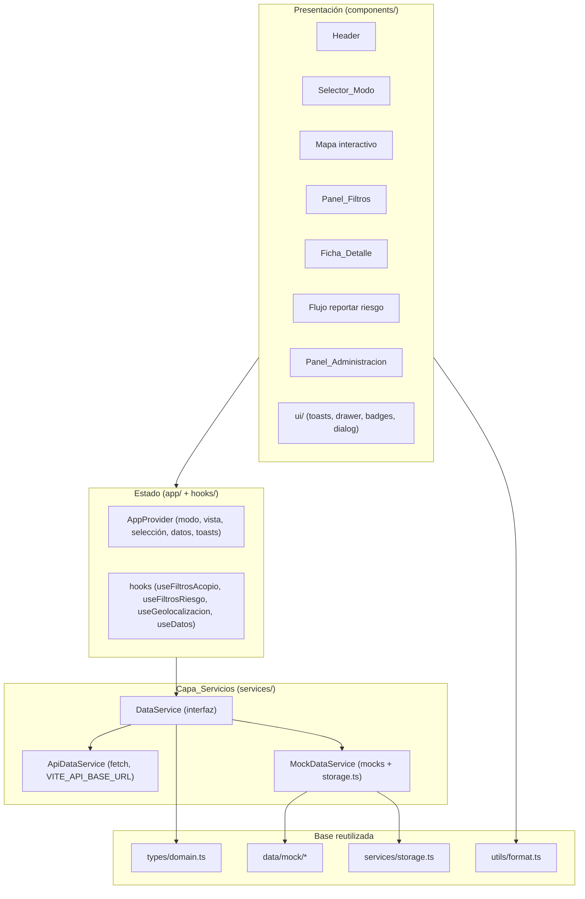
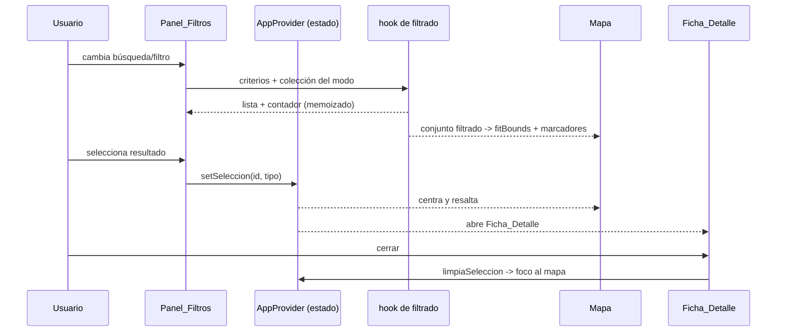
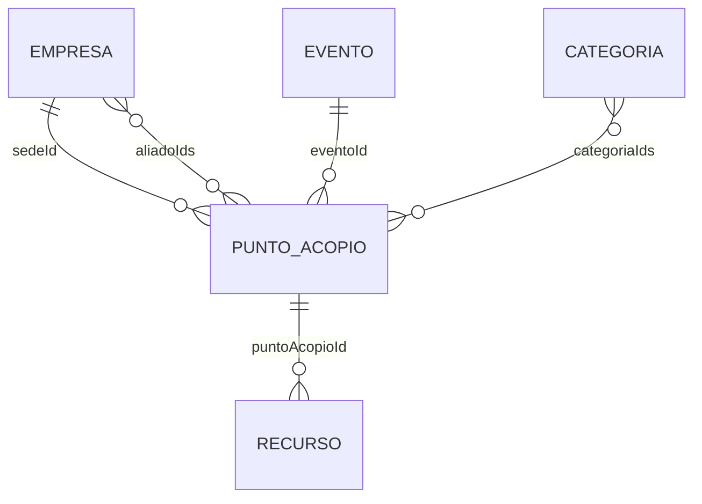

# Design Document

## Overview

Este documento describe el diseño del **frontend** de "Real Plaza Contigo" (Req.
Introduction), una SPA en React 18 + TypeScript + Vite + Tailwind que presenta
dos modos de trabajo sobre un mapa interactivo (Leaflet + OpenStreetMap):
**Centros de acopio** y **Reporte de puntos críticos**. El alcance es
exclusivamente el proyecto `frontend/`; el backend queda fuera, pero todo acceso
a datos pasa por una **Capa de Servicios** configurable por `VITE_API_BASE_URL`
que está preparada para consumir una API real con respaldo a mocks +
`localStorage` (Req. 12).

El diseño **reutiliza el código ya scaffolded** y no lo recrea:

- `frontend/src/types/domain.ts` — entidades y enums del dominio (`Empresa`,
  `Categoria`, `Evento`, `Recurso`, `PuntoAcopio`, `PuntoRiesgo`, `ModoApp`,
  `EstadoOperativo`, `SeveridadRiesgo`, `EstadoReporte`, `TipoIncidente`,
  `PuntoAcopioInput`, `PuntoRiesgoInput`). Se referencian, no se redefinen.
- `frontend/src/data/mock/*` — datasets de demostración (`empresas`,
  `categorias`, `eventos`, `puntosAcopio`, `recursos`, `puntosRiesgo`) y el
  barrel `index.ts`.
- `frontend/src/utils/format.ts` — mapas de etiquetas
  (`etiquetaEstadoOperativo`, `etiquetaSeveridad`, `etiquetaEstadoReporte`,
  `etiquetaTipoIncidente`, `etiquetaTipoDesastre`, `etiquetaEstadoEvento`),
  `formatearFecha`, `nivelOcupacion`, `urlComoLlegar`.
- `frontend/src/services/storage.ts` — acceso tipado a `localStorage` con
  prefijo `rpc:` (`leer`, `escribir`, `eliminar`, `generarId`).
- Configuración ya presente: Vite + React 18 + TS, Tailwind con tokens
  `brand/ink/surface/status/risk`, `react-leaflet` + `leaflet` +
  `react-leaflet-cluster`, `lucide-react`, `framer-motion`, alias `@ -> src`.

Objetivos de diseño alineados al steering: separar lógica de negocio y
presentación, centralizar tipos y acceso a datos, reutilizar hooks de filtrado
para ambos modos, evitar componentes monolíticos, mantener estado coherente
entre mapa/filtros/modo/selección/administración, y dejar siempre claro el
carácter **ficticio y de demostración** de los datos (Req. 15).

## Architecture

### Capas



La presentación nunca accede a `localStorage`, `fetch` ni a los mocks
directamente: siempre pasa por la Capa de Servicios a través de los hooks
(Req. 12.1, 12.4).

### Estructura de carpetas (alineada al steering)

```
frontend/src/
  app/
    App.tsx                 # composición raíz: Header + vista activa
    AppProvider.tsx         # contexto global (estado + acciones)
    rutas.ts                # vista: 'mapa' | 'administracion'
  components/
    layout/                 # Header, contenedores responsive, SafeArea
    map/                    # MapaBase, MarcadoresAcopio, ZonasRiesgo, controles
    filters/                # PanelFiltros, FiltrosAcopio, FiltrosRiesgo, ListaResultados
    points/                 # FichaDetalleAcopio, PopupAcopio, tarjetas
    events/                 # FichaEvento / modal de evento asociado
    risk/                   # FichaDetalleRiesgo, FlujoReporteRiesgo, PreviewRadio
    administration/         # PanelAdministracion, FormAcopio, FormRiesgo, Tabla
    ui/                     # Boton, Drawer/BottomSheet, Badge, Dialogo, Toasts, Campo
  data/mock/                # (existente) datasets de demostración
  hooks/                    # useDatos, useFiltrosAcopio, useFiltrosRiesgo, useGeolocalizacion, useToasts, usePrefersReducedMotion
  services/                 # dataService (interfaz + impls), storage.ts (existente)
  types/                    # domain.ts (existente) + ui.ts (view-models, filtros)
  utils/                    # format.ts (existente) + geo.ts, texto.ts
```

### Gestión de estado (hooks + contexto)

Se usa un **contexto único** (`AppProvider`) con `useReducer` para el estado
transversal, evitando una librería de estado externa (no agregar dependencias
innecesarias). El estado contiene:

- `modo: ModoApp` — modo activo (Req. 1).
- `vista: 'mapa' | 'administracion'` — vista activa (Req. 10.1).
- `datos` — colecciones cargadas desde la Capa de Servicios (acopio, riesgo,
  empresas, categorías, eventos, recursos) y banderas `cargando` / `error`.
- `seleccionId: string | null` y `seleccionTipo: ModoApp | null` — punto/zona
  seleccionada (Req. 3.5, 3.6).
- `modoDemo: boolean` — si la Capa de Servicios opera en respaldo (Req. 12.3),
  usado por el Indicador_DEMO y la acción de restaurar (Req. 10.10).
- `toasts` — mensajes de éxito/error (Req. 14.5).

El filtrado **no** vive en el estado global: cada panel usa un hook de filtrado
memoizado (`useFiltrosAcopio`, `useFiltrosRiesgo`) que recibe la colección del
modo y el estado local de filtros, y deriva la lista y el contador. El mapa se
suscribe al mismo resultado filtrado del modo activo para su encuadre
(fitBounds) y marcadores (Req. 3.7, 5.3, 6.3).

### Flujo de datos (mapa / filtros / modo / selección / administración)



Las mutaciones (crear/editar/eliminar/resolver/reportar/restaurar) llaman a la
Capa de Servicios; al resolver, `AppProvider` actualiza las colecciones y tanto
el mapa como las listas se recalculan de inmediato (Req. 8.6, 9.5, 10.4–10.6,
10.11).

## Components and Interfaces

### Header (`components/layout/Header.tsx`) — Req. 11

- Logotipo tipográfico "Real Plaza Contigo" y lema "Una red de apoyo para
  nuestras comunidades" (Req. 11.1), con la marca Real Plaza (Req. 15.1).
- **Indicador_DEMO** visible siempre (badge "DEMO") (Req. 11.2, 15.2).
- Contiene el `Selector_Modo`, el control Mapa/Administración y el control de
  ubicación (Req. 11.3).
- Layout flex con envoltura y truncado para no provocar scroll horizontal
  desde 360px (Req. 11.4, 13.1). En móvil, los controles secundarios se
  colapsan en un menú compacto.

### Selector_Modo (`components/layout/SelectorModo.tsx`) — Req. 1

- Dos opciones con **etiqueta textual + icono** (`lucide-react`): "Centros de
  acopio" (p. ej. `PackageOpen`) y "Reporte de puntos críticos" (p. ej.
  `TriangleAlert`) (Req. 1.1).
- Implementado como grupo de botones con `role="tablist"` /
  `aria-selected`; el modo activo se distingue por **peso, borde y un indicador
  de icono/estado textual**, no solo color (Req. 1.6, 14.1).
- Visible en escritorio y en ancho ≥ 360px (Req. 1.2).
- Cambiar de modo actualiza `modo` en el estado; el mapa permanece montado
  durante la transición (sin desmontar `MapContainer`) (Req. 1.3–1.5).

```ts
interface SelectorModoProps {
  modo: ModoApp;
  onCambiarModo: (modo: ModoApp) => void;
}
```

### Mapa interactivo (`components/map/`) — Req. 2, 3, 4

Composición sobre `react-leaflet`:

- `MapaBase` — `MapContainer` centrado en Lima Metropolitana
  (`[-12.0464, -77.0428]`, zoom ~11) (Req. 2.1), con `TileLayer` de OSM sin API
  key y `attribution` de OpenStreetMap visible (Req. 2.2, 2.3). Zoom/paneo
  nativos de Leaflet (Req. 2.4).
- **Estados de teselas**: overlay de carga mientras cargan (evento `loading`
  del `TileLayer`) (Req. 2.5) y banner de error ante fallos de red del tile
  layer (evento `tileerror`) (Req. 2.6).
- `ControlVolverInicio` — botón que restablece centro/zoom inicial (Req. 2.7).
- `ControlUbicacion` — usa `useGeolocalizacion`; al conceder permiso centra el
  mapa en la posición (Req. 4.1, 4.2); si se deniega o falla, muestra toast
  "Ubicación no disponible" y conserva la vista (Req. 4.3).
- `AjusteEncuadre` — hook interno que ejecuta `map.fitBounds` sobre el conjunto
  filtrado del modo activo cuando cambia; si el conjunto está vacío conserva una
  vista válida (Req. 3.7, 3.8).

**Marcadores de acopio** (`MarcadoresAcopio`) — por cada `PuntoAcopio` del
conjunto filtrado, un `Marker` con `divIcon` (HTML) que combina **icono de
categoría principal** + **forma/decoración por `EstadoOperativo`** (p. ej. anillo
sólido/discontinuo + glifo), de modo que no dependa solo del color (Req. 3.1,
14.1). Agrupados con `react-leaflet-cluster` cuando superan un umbral (Req.
3.3). `Popup` con datos resumidos (Req. 3.4); clic abre la Ficha_Detalle (Req.
3.5).

**Zonas de riesgo** (`ZonasRiesgo`) — por cada `PuntoRiesgo` filtrado, un
`Circle` con `radioMetros` (color/relleno por severidad) + un `Marker` central
con `divIcon` distinto del de acopio (triángulo de advertencia) (Req. 3.2).
`Popup` resumido y apertura de Ficha_Detalle (Req. 3.4, 3.5).

**Selección** — el punto/zona seleccionada recibe un realce (anillo/elevación o
`Circle` con borde reforzado) distinto del resto (Req. 3.6).

```ts
interface MapaProps {
  modo: ModoApp;
  acopioFiltrado: PuntoAcopioVista[];
  riesgoFiltrado: PuntoRiesgo[];
  seleccionId: string | null;
  onSeleccionar: (id: string, tipo: ModoApp) => void;
  // flujo de reporte (Req. 9)
  reporteActivo: boolean;
  borradorReporte: BorradorReporte | null;
  onElegirUbicacion: (c: Coordenada) => void;
}
```

### Panel_Filtros (`components/filters/`) — Req. 5, 6

Panel lateral en escritorio; en móvil, panel inferior compacto y deslizable que
no oculta el mapa, con lista de resultados deslizable (Req. 13.3). Renderiza
`FiltrosAcopio` o `FiltrosRiesgo` según el modo (Req. 1.3, 1.4).

- **Acopio** (Req. 5): buscador de texto (nombre, sede, aliado, dirección,
  distrito) (Req. 5.1); filtros por categoría, estado operativo, evento y
  distrito (Req. 5.2); contador (Req. 5.4); lista (Req. 5.5); seleccionar
  resultado centra el mapa y abre la ficha (Req. 5.6); limpiar filtros (Req.
  5.7); estado vacío con acción de limpiar (Req. 5.8).
- **Riesgo** (Req. 6): buscador (descripción, tipo, distrito) (Req. 6.1);
  filtros por tipo de incidente, severidad y estado del reporte (Req. 6.2);
  contador (Req. 6.4); seleccionar centra y abre ficha (Req. 6.5); limpiar
  (Req. 6.6); estado vacío (Req. 6.7).

**Hook de filtrado reutilizable** — para evitar duplicación (steering), un
núcleo genérico `aplicarFiltros(items, { predicados })` compone predicados de
texto y de igualdad por campo. `useFiltrosAcopio` y `useFiltrosRiesgo` lo
configuran con sus campos:

```ts
// types/ui.ts
interface FiltrosAcopio {
  texto: string;
  categoriaId: string | null;
  estado: EstadoOperativo | null;
  eventoId: string | null;
  distrito: string | null;
}
interface FiltrosRiesgo {
  texto: string;
  tipo: TipoIncidente | null;
  severidad: SeveridadRiesgo | null;
  estado: EstadoReporte | null;
}
interface ResultadoFiltro<T> { items: T[]; total: number; }
```

```ts
// hooks
function useFiltrosAcopio(
  puntos: PuntoAcopioVista[], filtros: FiltrosAcopio
): ResultadoFiltro<PuntoAcopioVista>;

function useFiltrosRiesgo(
  puntos: PuntoRiesgo[], filtros: FiltrosRiesgo
): ResultadoFiltro<PuntoRiesgo>;
```

El resultado es memoizado (`useMemo`) sobre `items`+`filtros`; su `items`
alimenta la lista, el contador y los marcadores del mapa simultáneamente (Req.
5.3, 6.3).

### Ficha_Detalle de acopio (`components/points/FichaDetalleAcopio.tsx`) — Req. 7

Drawer lateral en escritorio y bottom sheet en móvil (Req. 13.4), construido
sobre `ui/Drawer`. Muestra toda la información del punto (Req. 7.1) con
jerarquía estado → ubicación → recursos → disponibilidad (Req. 7.2), resolviendo
por ID la sede, aliados, categorías, evento y recursos (ver Data Models). RUC y
teléfono se etiquetan como **ficticios de demostración** (Req. 7.3, 15.2).

Acciones:

- "Cómo llegar" → abre `urlComoLlegar(coordenada)` en Google Maps (Req. 7.4).
- "Copiar dirección" → `navigator.clipboard.writeText` + toast de confirmación
  (Req. 7.5).
- "Compartir punto" → `navigator.share` si existe; si no, copia un enlace al
  punto al portapapeles (Req. 7.6, 7.7).
- "Ver evento" (si hay `eventoId`) → abre `FichaEvento` (Req. 7.8).
- Cerrar → oculta la ficha y devuelve el foco al mapa (Req. 7.9, 14.4).

### Ficha_Detalle de riesgo (`components/risk/FichaDetalleRiesgo.tsx`) — Req. 8

Mismo patrón drawer/bottom sheet. Muestra tipo de incidente, severidad con
**etiqueta + icono**, descripción, distrito, coordenadas, radio perimetral,
fecha/hora de reporte y estado (Req. 8.1, 14.1). Se identifica como **reporte
ciudadano de demostración** (Req. 8.2, 15.2).

Acciones: "Cómo llegar" (Req. 8.3), "Compartir" con fallback (Req. 8.4, 8.5),
"Resolver o eliminar reporte" con diálogo de confirmación que llama a la Capa de
Servicios y refresca mapa y lista (Req. 8.6), y cerrar devolviendo el foco (Req.
8.7).

### Flujo de reportar zona de riesgo (`components/risk/FlujoReporteRiesgo.tsx`) — Req. 9

Disponible solo en Modo_Riesgo (Req. 9.1). Máquina de pasos simple y usable con
una mano desde 360px (Req. 9.4, 13.5):

1. **Ubicar**: el usuario toca el mapa; se registra la coordenada central (Req.
   9.2). El mapa entra en modo "elegir ubicación" (`useMapEvents` → `click`).
2. **Ajustar radio**: control deslizante que actualiza `radioMetros`; el mapa
   muestra un `Circle` de **vista previa** en tiempo real (Req. 9.3).
3. **Detallar y confirmar**: formulario con tipo de incidente, severidad y
   descripción. Validación: si falta tipo, severidad, descripción o radio, se
   muestra mensaje y se impide confirmar (Req. 9.6). Al confirmar, la Capa de
   Servicios persiste el nuevo `PuntoRiesgo` (en Modo_Demo, en `localStorage`) y
   aparece de inmediato en el mapa (Req. 9.5, 9.7).

```ts
interface BorradorReporte {
  coordenada: Coordenada | null;
  radioMetros: number;        // default p. ej. 250
  tipo: TipoIncidente | null;
  severidad: SeveridadRiesgo | null;
  descripcion: string;
}
```

### Panel_Administracion (`components/administration/`) — Req. 10

Acceso desde el Header (Req. 10.1). Según el modo activo muestra el listado de
acopio (búsqueda + filtros por categoría y estado) o de riesgo (búsqueda +
filtros por tipo, severidad y estado) reutilizando los mismos hooks de filtrado
(Req. 10.2, 10.3). Sigue siendo utilizable en móvil mediante tabla con scroll y
formularios en bottom sheet (Req. 13.7).

- `FormAcopio` — selectores de sede, aliados, evento y categorías, más
  dirección, coordenadas, capacidad, estado y contacto (Req. 10.8). Valida
  campos requeridos con mensajes por campo (Req. 10.7).
- `FormRiesgo` — tipo de incidente, severidad, radio, descripción y estado
  (Req. 10.9), con validación por campo (Req. 10.7).
- Crear/editar/eliminar llaman a la Capa de Servicios y reflejan el cambio en
  listado y mapa (Req. 10.4–10.6); eliminar pide confirmación (Req. 10.6).
- En Modo_Demo, acción "Restaurar datos de demostración" con confirmación que
  repuebla `localStorage` con los mocks iniciales y refresca todo (Req. 10.10,
  10.11).

### Capa de Servicios (`services/dataService.ts`) — Req. 12

Interfaz única que abstrae el origen de datos. La presentación depende de la
interfaz, no de la implementación (Req. 12.1).

```ts
// services/dataService.ts
export interface DataService {
  readonly esDemo: boolean;

  cargarTodo(): Promise<DatosDominio>; // empresas, categorias, eventos, recursos, acopio, riesgo

  crearAcopio(input: PuntoAcopioInput): Promise<PuntoAcopio>;
  editarAcopio(id: string, input: PuntoAcopioInput): Promise<PuntoAcopio>;
  eliminarAcopio(id: string): Promise<void>;

  crearRiesgo(input: PuntoRiesgoInput): Promise<PuntoRiesgo>;
  editarRiesgo(id: string, cambios: Partial<PuntoRiesgo>): Promise<PuntoRiesgo>;
  resolverRiesgo(id: string): Promise<PuntoRiesgo>;   // estado -> 'resuelto'
  eliminarRiesgo(id: string): Promise<void>;

  restaurarDemo(): Promise<void>; // solo Modo_Demo
}

export interface DatosDominio {
  empresas: Empresa[];
  categorias: Categoria[];
  eventos: Evento[];
  recursos: Recurso[];
  puntosAcopio: PuntoAcopio[];
  puntosRiesgo: PuntoRiesgo[];
}
```

**Selección de implementación** (estrategia) — una fábrica decide en tiempo de
ejecución:

```ts
export function crearDataService(): DataService {
  const base = import.meta.env.VITE_API_BASE_URL as string | undefined;
  if (base && base.trim() !== '') {
    return new ApiDataService(base); // con fallback a mock ante fallo de red
  }
  return new MockDataService();
}
```

- `ApiDataService` — usa `fetch` contra `${VITE_API_BASE_URL}/...` con rutas y
  errores uniformes (Req. 12.2). Si una petición de **lectura inicial** falla
  (red/timeout), el servicio cae a `MockDataService` y marca `esDemo = true`,
  de modo que la demo siga navegable (Req. 12.3). Las rutas se declaran pero su
  backend está fuera de alcance.
- `MockDataService` — fuente de verdad en Modo_Demo. Inicializa su estado desde
  `data/mock/*`, lo persiste y lee con `storage.ts` (prefijo `rpc:`), y expone
  todas las operaciones CRUD (Req. 12.3, 12.4):
  - **create-stable-id**: al crear usa `generarId('pa' | 'pr')` de `storage.ts`
    para un identificador estable (Req. 12.5).
  - **relaciones por ID**: acopio referencia `sedeId`, `aliadoIds[]`,
    `eventoId`, `categoriaIds[]`; los recursos referencian `puntoAcopioId`. No
    se duplica información de sedes/aliados/eventos (Req. 12.6).
  - **restaurar demo**: `restaurarDemo()` elimina las claves `rpc:` y vuelve a
    sembrar desde los mocks (Req. 10.11).

Claves de `localStorage` (vía `storage.ts`): `rpc:puntosAcopio`,
`rpc:puntosRiesgo`, `rpc:recursos` (las colecciones de catálogo —empresas,
categorías, eventos— se consideran estáticas en demo y no requieren escritura,
pero se cachean para lectura consistente).

### Componentes UI compartidos (`components/ui/`)

`Boton`, `Campo` (input/label/mensaje de error accesibles), `Badge` (estado con
icono + etiqueta), `Drawer`/`BottomSheet` (responsive), `Dialogo` (confirmación)
y `Toasts` (mensajes de éxito/error). Todas con foco visible y `aria-*`
apropiados (Req. 14.2, 14.3, 14.5).

## Data Models

Las entidades del dominio **ya están definidas** en
`frontend/src/types/domain.ts` y se usan tal cual: `Empresa`, `Categoria`,
`Evento`, `Recurso`, `PuntoAcopio`, `PuntoRiesgo`, con los enums
`EstadoOperativo`, `SeveridadRiesgo`, `EstadoReporte`, `TipoIncidente`,
`TipoDesastre`, `EstadoEvento`, `EstadoDisponibilidad`, `ModoApp` y los inputs
`PuntoAcopioInput` / `PuntoRiesgoInput`.

### Relaciones (por ID)



### View-models / estado derivado (`types/ui.ts`)

Para la presentación se derivan vistas enriquecidas sin duplicar datos
persistidos; se resuelven por ID en el momento de render (o memoizados por el
hook `useDatos`):

```ts
interface PuntoAcopioVista extends PuntoAcopio {
  sede: Empresa | null;
  aliados: Empresa[];
  categorias: Categoria[];
  evento: Evento | null;
  recursos: Recurso[];
  ocupacionPct: number; // nivelOcupacion(capacidad, ocupacion), 0..100
}
```

- `ocupacionPct` se calcula con `nivelOcupacion` de `utils/format.ts`, que ya
  acota el resultado a `[0, 100]` (Req. 7.1, 7.2).
- Las etiquetas de estado/severidad/tipo se obtienen de los mapas de
  `utils/format.ts` (Req. 14.1).
- `FiltrosAcopio`, `FiltrosRiesgo` y `ResultadoFiltro<T>` (ver Panel_Filtros)
  modelan el estado de filtrado y su resultado.
- `BorradorReporte` (ver flujo de reporte) modela el reporte en construcción.

Los valores por defecto de los filtros representan "sin filtro" (`texto: ''`,
selects en `null`), de modo que el conjunto filtrado por defecto es la colección
completa del modo.

## Correctness Properties

*Una propiedad es una característica o comportamiento que debe cumplirse en todas
las ejecuciones válidas del sistema: una afirmación formal sobre lo que el
sistema debe hacer. Las propiedades son el puente entre la especificación legible
por humanos y las garantías de corrección verificables por máquina.*

La mayor parte de la lógica verificable del frontend es pura (filtrado,
derivación de view-models, formateo de URLs, validación, mutaciones sobre
colecciones y persistencia en `localStorage`). Las siguientes propiedades se
escriben para pruebas basadas en propiedades sobre esa lógica. El render visual,
la interacción con Leaflet y las APIs del navegador se cubren con pruebas
example/integración (ver Testing Strategy).

### Property 1: El modo activo determina el contenido visible

*Para cualquier* colección de puntos de acopio y de riesgo y cualquier
`ModoApp`, el conjunto de elementos derivado para el mapa y la lista contiene
exclusivamente elementos del tipo correspondiente al modo activo (solo acopio en
Modo_Acopio, solo riesgo en Modo_Riesgo).

**Validates: Requirements 1.3, 1.4**

### Property 2: El filtrado es correcto y completo

*Para cualquier* colección de puntos del modo activo y cualquier estado de
filtros, el resultado del hook de filtrado cumple: (a) todo elemento del
resultado satisface el predicado combinado (texto + filtros por campo); (b) todo
elemento de la colección que satisface el predicado está en el resultado; (c) el
contador reportado es igual a la longitud del resultado; y (d) el resultado es un
subconjunto de la colección de entrada. Aplica tanto al filtrado de acopio como
al de riesgo (mismo núcleo parametrizado por predicado).

**Validates: Requirements 5.1, 5.2, 5.3, 5.4, 6.1, 6.2, 6.3, 6.4**

### Property 3: Limpiar filtros restaura la colección completa

*Para cualquier* colección y cualquier estado de filtros, aplicar la acción de
limpiar filtros produce un resultado igual (mismos elementos) a la colección de
entrada completa del modo activo.

**Validates: Requirements 5.7, 5.8, 6.6, 6.7**

### Property 4: El nivel de ocupación está acotado a [0, 100]

*Para cualquier* par de valores `capacidad` y `ocupacion`, `nivelOcupacion`
devuelve un entero dentro del rango cerrado [0, 100] (0 cuando la capacidad no es
positiva).

**Validates: Requirements 7.1, 7.2**

### Property 5: "Cómo llegar" incluye las coordenadas del punto

*Para cualquier* coordenada `{ lat, lng }`, la URL generada por `urlComoLlegar`
contiene el destino exacto `lat,lng`, de modo que abre Google Maps hacia ese
punto.

**Validates: Requirements 7.4, 8.3**

### Property 6: Los identificadores creados son estables y únicos

*Para cualquier* cantidad de entidades creadas en Modo_Demo, cada identificador
generado respeta el prefijo de su tipo y todos los identificadores generados son
mutuamente distintos.

**Validates: Requirements 12.5**

### Property 7: Las mutaciones CRUD preservan las invariantes de colección

*Para cualquier* colección y entrada válida: crear añade exactamente un elemento
recuperable por su id; editar preserva el id y aplica los cambios dejando el
tamaño de la colección sin cambios; eliminar retira exactamente el elemento con
ese id y deja el resto intacto. Aplica a puntos de acopio y de riesgo.

**Validates: Requirements 10.4, 10.5, 10.6**

### Property 8: Resolver o eliminar un reporte de riesgo tiene el efecto esperado

*Para cualquier* colección de puntos de riesgo y cualquier id existente,
resolver el reporte deja ese punto presente con `estado = 'resuelto'`, y
eliminar el reporte deja la colección sin ningún punto con ese id, sin afectar a
los demás.

**Validates: Requirements 8.6**

### Property 9: La persistencia en Modo_Demo es un round-trip

*Para cualquier* entidad (punto de acopio o de riesgo) creada o editada a través
de la Capa de Servicios en Modo_Demo, al releer el estado mediante una nueva
instancia del servicio que carga desde `localStorage`, la entidad persiste y es
equivalente a la escrita (permanece tras recargar).

**Validates: Requirements 9.5, 9.7, 10.4, 10.5**

### Property 10: Restaurar devuelve exactamente los datos mock iniciales

*Para cualquier* secuencia de mutaciones aplicadas en Modo_Demo, ejecutar
"restaurar datos de demostración" deja las colecciones persistidas iguales a los
datasets mock iniciales (`data/mock/*`).

**Validates: Requirements 10.10, 10.11**

### Property 11: La fábrica selecciona la implementación según el entorno

*Para cualquier* valor de `VITE_API_BASE_URL`, la fábrica de la Capa de
Servicios devuelve el cliente de API cuando el valor es una cadena no vacía (sin
contar espacios en blanco) y el servicio mock (con `esDemo = true`) cuando el
valor está ausente, vacío o solo con espacios.

**Validates: Requirements 12.2, 12.3**

### Property 12: El número de marcadores/zonas coincide con el conjunto filtrado

*Para cualquier* conjunto filtrado del modo activo, el número de marcadores de
acopio (en Modo_Acopio) o de zonas de riesgo (en Modo_Riesgo) producidos para el
mapa es igual al número de elementos del conjunto filtrado.

**Validates: Requirements 3.1, 3.2**

### Property 13: El view-model resuelve las relaciones por ID de forma consistente

*Para cualquier* punto de acopio, la vista enriquecida (`PuntoAcopioVista`)
resuelve `sede`, `aliados`, `categorias`, `evento` y `recursos` a partir de los
identificadores del punto, de modo que cada objeto resuelto corresponde a un id
referenciado por el punto (o `null`/vacío cuando el id no existe), sin duplicar
las entidades base.

**Validates: Requirements 12.6**

## Error Handling

- **Carga inicial de datos** (Req. 12.2, 12.3): `cargarTodo()` se invoca una vez
  al montar vía `useDatos`. Mientras resuelve, la UI muestra estados de carga
  (skeletons en listas, overlay en mapa). Si `ApiDataService` falla en la lectura
  inicial (red/timeout), se cae a `MockDataService`, se marca `esDemo = true` y
  se informa con un toast de modo demostración, sin bloquear la app.
- **Teselas del mapa** (Req. 2.5, 2.6): overlay de carga en `loading` y banner de
  error ante `tileerror`, conservando la vista actual.
- **Geolocalización** (Req. 4.3): permiso denegado o fallo → toast "Ubicación no
  disponible" y se conserva la vista del mapa; nunca se lanza excepción sin
  manejar.
- **Resultados vacíos de filtros** (Req. 5.8, 6.7): estado vacío diseñado, con
  mensaje claro y acción "Limpiar filtros"; el mapa conserva una vista válida sin
  marcadores (Req. 3.8).
- **Validación de formularios y de reporte** (Req. 9.6, 10.7): la validación
  devuelve un mapa de errores por campo; mientras existan errores se impide
  confirmar/guardar y se muestran mensajes junto a cada campo con `aria-invalid`
  y `aria-describedby`.
- **Operaciones de mutación**: si una operación de la Capa de Servicios rechaza,
  se muestra un toast de error (Req. 14.5) y el estado no se modifica (las
  mutaciones se aplican solo tras resolver con éxito).
- **Clipboard / Web Share** (Req. 7.5–7.7, 8.4, 8.5): se comprueba el soporte
  (`navigator.share`, `navigator.clipboard`) antes de usarlos; ante ausencia o
  rechazo se usa el fallback de copiar enlace y se informa el resultado con un
  toast.
- **Confirmaciones destructivas** (Req. 8.6, 10.6, 10.11): eliminar/resolver y
  restaurar datos requieren un diálogo de confirmación antes de llamar a la Capa
  de Servicios.

## Testing Strategy

Herramientas: **Vitest** + **@testing-library/react** + **jsdom** para unidad y
componentes; **fast-check** para pruebas basadas en propiedades; **@axe-core/react**
(o `jest-axe` adaptado a Vitest) para comprobaciones de accesibilidad. Estas
dependencias de desarrollo se añaden al `frontend/package.json`. El entorno de
Leaflet se simula (jsdom no renderiza mapas reales); se verifica la lógica y las
llamadas a la API de Leaflet con mocks.

### Pruebas basadas en propiedades (fast-check)

- Se implementa **una** prueba de propiedad por cada propiedad de la sección
  Correctness Properties (Property 1–13).
- Cada prueba corre un **mínimo de 100 iteraciones** (`fc.assert(..., { numRuns: 100 })`).
- Cada prueba se etiqueta con un comentario que referencia la propiedad del
  diseño, con el formato:
  `// Feature: frontend-mvp, Property {número}: {texto de la propiedad}`.
- No se implementa un motor de PBT propio; se usa `fast-check`.
- Objetivos principales de PBT: lógica de filtrado (P2, P3), `nivelOcupacion`
  (P4), `urlComoLlegar` (P5), `generarId`/ids (P6), mutaciones del
  `MockDataService` (P7, P8), round-trip con `storage.ts` (P9, P10), fábrica de
  servicios (P11), derivación de conjunto por modo y cardinalidad (P1, P12) y
  resolución de view-models por ID (P13). Se usan generadores (`fc.record`,
  `fc.constantFrom` sobre los enums del dominio) y, para la persistencia, un
  `localStorage` simulado en jsdom.

### Pruebas unitarias y de componentes (example / edge)

Complementan a las propiedades en casos concretos y de integración de UI:

- **Selector_Modo / Header**: presencia de etiquetas + iconos, indicador DEMO,
  distinción del modo activo sin depender solo del color (Req. 1.6, 11.1–11.4,
  14.1).
- **Mapa**: center/zoom iniciales (Req. 2.1), control de volver a inicio (Req.
  2.7), estados de teselas carga/error con eventos simulados (Req. 2.5, 2.6),
  fitBounds invocado al cambiar el conjunto y sin fallo en conjunto vacío (Req.
  3.7, 3.8), forma/icono de marcadores por categoría+estado y marcador central
  de riesgo (Req. 3.1, 3.2).
- **Geolocalización**: mock de `navigator.geolocation` concediendo/denegando
  (Req. 4.2, 4.3).
- **Fichas de detalle**: render de todos los campos y de la marca de dato
  ficticio (Req. 7.1–7.3, 8.1, 8.2); acciones copiar/compartir con y sin soporte
  (Req. 7.5–7.7, 8.4, 8.5); ver evento (Req. 7.8); cierre que devuelve el foco
  al mapa (Req. 7.9, 8.7).
- **Flujo de reporte**: registrar coordenada al tocar el mapa y preview del
  `Circle` al ajustar el radio (Req. 9.2, 9.3), usabilidad a 360px (Req. 9.4).
- **Capa de Servicios**: fallback ante fallo de red del `ApiDataService` usando
  `fetch` mockeado que rechaza (Req. 12.3).
- **Accesibilidad**: foco visible, etiquetas accesibles, navegación por teclado
  en controles principales y `prefers-reduced-motion` simulado reduciendo
  animaciones de framer-motion (Req. 14.2–14.6); auditoría axe en vistas clave.
- **Responsive** (Req. 13): verificación de ausencia de scroll horizontal a
  360px y de bottom sheets en móvil mediante pruebas de layout con viewport
  reducido.
- **Marca/veracidad** (Req. 15): presencia de la marca Real Plaza y de marcas de
  dato ficticio en las vistas principales.

### Balance

Las propiedades cubren la corrección general de la lógica pura con amplia
cobertura de entradas; las pruebas example/edge cubren interacciones concretas,
integración con Leaflet/navegador y accesibilidad. Se evita duplicar en unit
tests lo ya garantizado por las propiedades.
